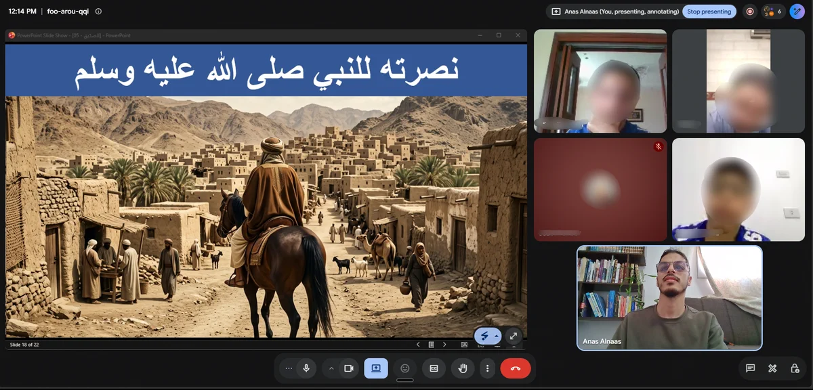

# Images — what to produce and where it goes

Every image on the site is referenced by an **exact filename**. Match the
filenames below and the site picks the new photos up with no code changes.

All the placeholder files currently in `images/` are the five photos from the
old site, already resized and converted. Overwrite them.

---

## The files the site expects

| File | Pixels | Ratio | Used for | Keep under |
|---|---|---|---|---|
| `images/portrait.webp` | 640 × 640 | 1:1 | Your photo in the hero | 80 KB |
| `images/portrait@2x.webp` | 960 × 960 | 1:1 | Same photo for retina screens | 140 KB |
| `images/about.webp` | 1280 × 960 | 4:3 | The photo in the "Your teacher" section | 160 KB |
| `images/gallery-1.webp` … `gallery-5.webp` | 800 wide | 4:3 | Gallery tiles | 120 KB each |
| `images/gallery-1-large.webp` … `gallery-5-large.webp` | 1600 wide | 4:3 | Opened in the lightbox | 250 KB each |
| `images/gallery-6.webp` / `-large.webp` | 1200 / 1911 wide | 2.08:1 | The Sirah session screenshot — a **wide tile**, see below | 120 / 200 KB |
| `images/og.jpg` | 1200 × 630 | 1.91:1 | The preview when the link is shared | 200 KB |

Two rules that matter:

1. **`og.jpg` must stay a JPEG or PNG — never WebP.** WhatsApp, Telegram and
   Facebook do not reliably render WebP in link previews, and this image *is*
   the link preview. It is the one file that is not WebP.
2. **The gallery tiles are cropped to 4:3 by the layout.** A portrait photo
   will have its top and bottom cut off. Crop to 4:3 yourself, so you choose
   what stays in frame rather than the CSS choosing for you.

---

## Converting with ffmpeg

You already have ffmpeg. These are the exact commands used for the current
files — `min(800,iw)` stops a small original from being upscaled into a big,
blurry file.

Gallery tile (800 wide):

```bash
ffmpeg -y -i photo.jpg -vf "scale='min(800,iw)':-2:flags=lanczos" -c:v libwebp -quality 80 -compression_level 6 -preset photo gallery-1.webp
```

Lightbox copy (1600 wide):

```bash
ffmpeg -y -i photo.jpg -vf "scale='min(1600,iw)':-2:flags=lanczos" -c:v libwebp -quality 76 -compression_level 6 -preset photo gallery-1-large.webp
```

Square portrait (centre crop, then resize):

```bash
ffmpeg -y -i portrait.jpg -vf "crop='min(iw,ih)':'min(iw,ih)',scale=640:640:flags=lanczos" -c:v libwebp -quality 82 -compression_level 6 -preset photo portrait.webp
```

Share image (JPEG, exact 1200 × 630):

```bash
ffmpeg -y -i photo.jpg -vf "scale=1200:630:force_original_aspect_ratio=increase,crop=1200:630" -q:v 3 og.jpg
```

If a file comes out bigger than the budget in the table, drop `-quality` by
about 8 and run it again. Photos with fine repeating detail — fences, foliage,
carpet patterns — compress badly; crop tighter rather than pushing quality
down until the photo looks soft.

---

## Adding a sixth gallery photo

Three edits.

**1. Add the files:** `images/gallery-6.webp` and `images/gallery-6-large.webp`.

**2. In `index.html`,** copy any existing `<figure class="gallery__item">`
block inside the gallery grid, paste it after the last one, and change three
things — `data-large`, `src`, and the `width`/`height` to the real pixel size of
your file:

```html
<figure class="gallery__item">
  <button class="gallery__btn" type="button" data-large="images/gallery-6-large.webp">
    <span class="gallery__frame">
      
      <span class="visually-hidden" data-i18n="gallery.openLabel">Open larger</span>
      <span class="gallery__zoom" aria-hidden="true">
        <svg class="icon"><use href="#i-expand"></use></svg>
      </span>
    </span>
  </button>
</figure>
```

**3. In `js/i18n.js`,** add `g6.alt` to **both** the `en` and the `ar` block,
next to the existing `g5.alt` entries.

The photos carry no visible captions. `alt` text is not a caption — it never
appears on screen. It is what a blind visitor hears and what Google reads, so
describe what is happening in the photo rather than writing "photo" or
"classroom".

The lightbox picks up the new tile on its own; the arrows already wrap around
whatever number of photos exist.

If a photo is missing or its filename is wrong, the tile removes itself rather
than showing a broken-image icon, and the lightbox skips over it. So a slot can
sit in the markup waiting for its file without anything looking broken.

---

## Wide tiles (screenshots and slides)

A screenshot is much wider than a photo — the Sirah session one is 2.08:1 — and
forcing it into a 4:3 tile would crop away a third of it. Those get a
double-width tile at their own proportions instead:

```html
<figure class="gallery__item gallery__item--wide">
```

and in `css/styles.css` the frame is told the real ratio:

```css
.gallery__item--wide .gallery__frame {
  aspect-ratio: 1911 / 918;   /* the screenshot's own dimensions */
}
```

Two things to know if you add another one:

**Change that `aspect-ratio` to match your file**, or the wide tile will crop
your image instead of the previous one.

**Keep a wide tile out of the last position.** The grid is three columns on a
desktop, and an item that takes two of them cannot squeeze into a single leftover
cell — it drops to the next row and leaves a visible hole where it would have
gone. Placing it first (as the Sirah screenshot is) fills the rows cleanly and
leaves the empty space at the very end, where it reads as normal. Below 700px the
grid is one column and the double width switches itself off.

---

## Putting a photo on a course card

Course cards currently show an Arabic word set in Amiri on a teal gradient.
To use a photo instead, replace the card's media block:

```html
<!-- from this -->
<div class="card__media card__media--glyph">
  <span class="card__glyph" aria-hidden="true">السِّيرَة</span>
  <span class="badge badge--live card__badge" data-i18n="now.liveBadge">Ongoing now</span>
</div>

<!-- to this -->
<div class="card__media">
  
  <span class="badge badge--live card__badge" data-i18n="now.liveBadge">Ongoing now</span>
</div>
```

Course card images want **16:10** (e.g. 800 × 500), not 4:3.

Worth knowing: the chalk photos — `السيرة النبوية` in chalk, and the
Isrā' wa Miʿrāj diagram — would work beautifully as the Seerah card's image.
The Arabic word marks are a deliberate design choice, though, not a stand-in
for missing photos. Mixing photo cards and word-mark cards in the same row
looks unresolved, so switch all five or none.
